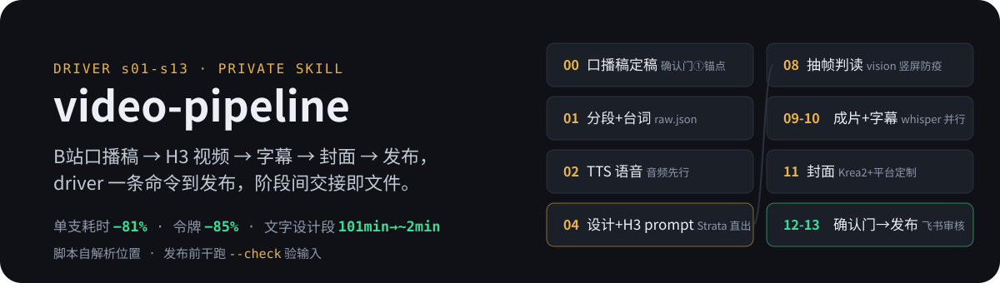

<p align="center">
  
</p>

# video-pipeline

B站口播稿 → H3视频 → 字幕 → 封面 → 发布全链路 Skill。

私有仓库，仅供本人使用。

> 📈 **优化演进史**：[docs/OPTIMIZATION-LOG.md](docs/OPTIMIZATION-LOG.md) —— 单支视频耗时 −81%、
> 令牌消耗 −85%、提示词阶段快 2.2 倍且零 API 费：每次大版本改了什么、优化多少、数据来源，节点式全记录。

> 🧭 **最新进展（2026-10-19）**：**消除安装位置假设（#152）**——发布链路（driver 视频号钩子、
> `sph_publish_v5.py`、`tencent_refresh_cookie.sh`）不再指向仓库外的另一份 git 副本，一律从
> **脚本自身位置**解析同仓邻居；旧副本已整份备份后改成指回本仓的 junction，**从哪份副本跑都是
> 同一份代码**。发布前可零副作用干跑 `python scripts/sph_publish_v5.py --check <日期>`
> （0=可发 / 3=输入缺失 / 2=日期非法），检测点 `scripts/test_install_location.py`（8 节，双端跑）。
>
> 此前（2026-10-12）：**LLM 后端全切本地 Strata（#82-#87）**——文案/结构
> 生成（压缩车道单次调用、legacy 四阶段链、封面文案、平台标题、翻转重写）全部从
> KVMem/8888/9router 切到本地 Strata（Qwen3.8-Flash-Next IQ3_S，Windows 主机 8080，
> WSL 经网关 IP 直连；热态生成 148-159 tok/s），**vision 判读是唯一云端例外**（多模态
> 与烧卡争显存）。生命周期全自动托管（strata_window）：探活→powershell 跨界拉起→失败
> 叫人阶梯 + conflict 显存窗口（常驻 94% VRAM 与生图互斥 → s08 生图前停、s11 前再拉、
> s12 确认门前停，单条视频常态两次加载）；杀掉 Strata 无人值守自愈演示通过（26s 冷启
> 就绪）。选型/连通/窗口纪律实测依据见 [ADR 0006](docs/adr/0006-strata-backend-and-window.md)
> 与 [spike 报告](docs/spikes/2026-10-12-strata-spike.md)；KVMem/8888 体系退役，
> [ADR 0004](docs/adr/0004-compressed-lane-kvmem.md) 车道设计保留、后端部分由 ADR 0006 取代。
>
> 此前（2026-09-25）：压缩车道首测评通过 + 确认门文档化（#61/#62/#55）——0922 期
> 不烧卡对照实测：IQ2_S 档文字段 101.4min → 1.7-3.0min；`--gate-approved` 浮出
> （agent 会话批准后带参重启续跑）。详见 [ADR 0004](docs/adr/0004-compressed-lane-kvmem.md)
> 与 [OPTIMIZATION-LOG 节点 7](docs/OPTIMIZATION-LOG.md)。

## 结构

```
video-pipeline/
├── SKILL.md              ← 总控：driver 用法/流程图/模型分配表/确认门协议（入口）
├── scripts/              ← driver + 各阶段执行脚本（每个 test_*.py 无框架自检直跑）
├── references/           ← 分阶段方法论（按需加载）
│   └── video-craft/      ← 跨系统共享方法论（personas/摄影/导演/书源决策表 + styles/）
├── docs/                 ← OPTIMIZATION-LOG + ADR + agents 协作文档
├── _test/                ← 测评现场与对照报告（如 ticket4-0922-lane-report.md）
└── assets/               ← README 素材
```

## 共享方法论（references/video-craft/）

`references/video-craft/` 放本 skill 与 OpenMontage 共用的方法论（personas、镜头语法、
摄影/导演/编剧书源决策表、15 个风格库）。**2026-10-15 起全部纳入本仓库 git 管理**，
引用一律用 skill 内相对路径。

历史背景：这批文件原先只存在于仓库外的 `~/references/video-craft/`，从未入库，导致
`shot-grammar.md` 被 SKILL.md 引用 3 次却在仓库中不存在（悬空指针）。现已收编入库。

兼容：`scripts/*.py` 的 `load_style()` 先查 skill 内
`references/video-craft/styles/`，再回退 `~/references/video-craft/styles/`。若要让
旧绝对路径继续可用，把 home 目录做成指回本仓库的 junction：

```powershell
# Windows（需先备份/删除原目录）
cmd /c rmdir "%USERPROFILE%\references\video-craft"
cmd /c mklink /J "%USERPROFILE%\references\video-craft" "<repo>\references\video-craft"
```

```bash
# WSL
rm -rf ~/references/video-craft
ln -s <repo>/references/video-craft ~/references/video-craft
```

## 运行方式：driver 一条命令（v3 默认）

`scripts/run_pipeline.py` 全自动编排 **s01-s13**（分段→发布），中间只有确认门
④+⑤ 一处飞书审核（发审核包后轮询回复；用户也可在 agent 会话明确批准后带
`--gate-approved` 重启续跑）；agent 仅在确认门与异常时回现场：

```bash
python3 scripts/run_pipeline.py --script <slug>/00_口播稿/口播稿.md   # 一条命令到发布
python3 scripts/run_pipeline.py --script ... --dry-run               # 只打印执行计划
```

stamps 断点续跑、每阶段失败自动重试、Strata/ComfyUI 等本地服务由 driver 托管
起停；用法变体/模型分配表/确认门协议见 [SKILL.md](SKILL.md)。agent/full 逐阶段
人工协作路径保留为遗留（非读报模式、单阶段旁路用）。

## 流程骨架与目录（目录号 = driver 阶段号配对）

创作层八阶段（口播稿 → 1A 整体视觉 → 1B 逐段设计 → 分镜增强 → H3 prompt →
生成合成 → 字幕/封面 → 发布）是方法论骨架；driver 把其中文字设计段压进 s04
单阶段（压缩车道），运行面为 **s01-s13 顺序编号**，每阶段有产出、自检门，阶段间
只传文件（`pipeline_contract.py` 强制）：

```
<slug>/                        ← 每稿自包含文件夹（目录号 = 阶段号 s01-s13 配对）
├── 00_口播稿/                  ← 输入锚点（确认门①在 driver 之前定稿，永不改）
├── 01_分段/                    ← s01：分镜清单_raw.json + 口播台词/（TTS 输入）
├── 02_TTS语音/                 ← s02：shotXX.wav（音频先行，时长权威）
├── 03_导演设计/                ← s04：方向卡+整体方案+shotXX 设计（压缩车道=单次调用直出）
├── 04_分镜增强/ 05_美术画质/    ← s05/s06（legacy 车道实阶段；compressed 写虚拟 stamp）
├── 06_H3prompt/                ← s07：shotXX.json（compressed 由 s04 一次直出）
├── 07_成片/                    ← s08-s10：H3 原始段 + 装配 + 最终成片.mp4
├── 08_字幕/                    ← s10：字幕.srt（whisper CPU 与 GPU 并行）
├── 09_封面/                    ← s11：Krea2 海报 + 平台标题.json
├── 10_发布/                    ← s13：发布核验报告.md（B站/抖音自动发，视频号待发文件夹）
└── _driver/                    ← stamps（stage_sXX.json）+ report.json 台账
```

s12 = 确认门④+⑤（成片+封面合并审核，发布前唯一闸门，不可跳过）。存量旧布局
用 `scripts/migrate_project_dirs.py <slug>` 迁移。发布细节：快手封面存活自动
核验+补传内建于 social-auto-upload；视频号 cookie 续期一键
`scripts/tencent_refresh_cookie.sh <账号> --launch`（Windows Chrome 扫码即完成）；
视频号发布前可零副作用干跑 `python scripts/sph_publish_v5.py --check <日期>`
（0=可发 / 3=输入缺失 / 2=日期非法，不碰 Chrome、不发飞书、不写 marker）。
